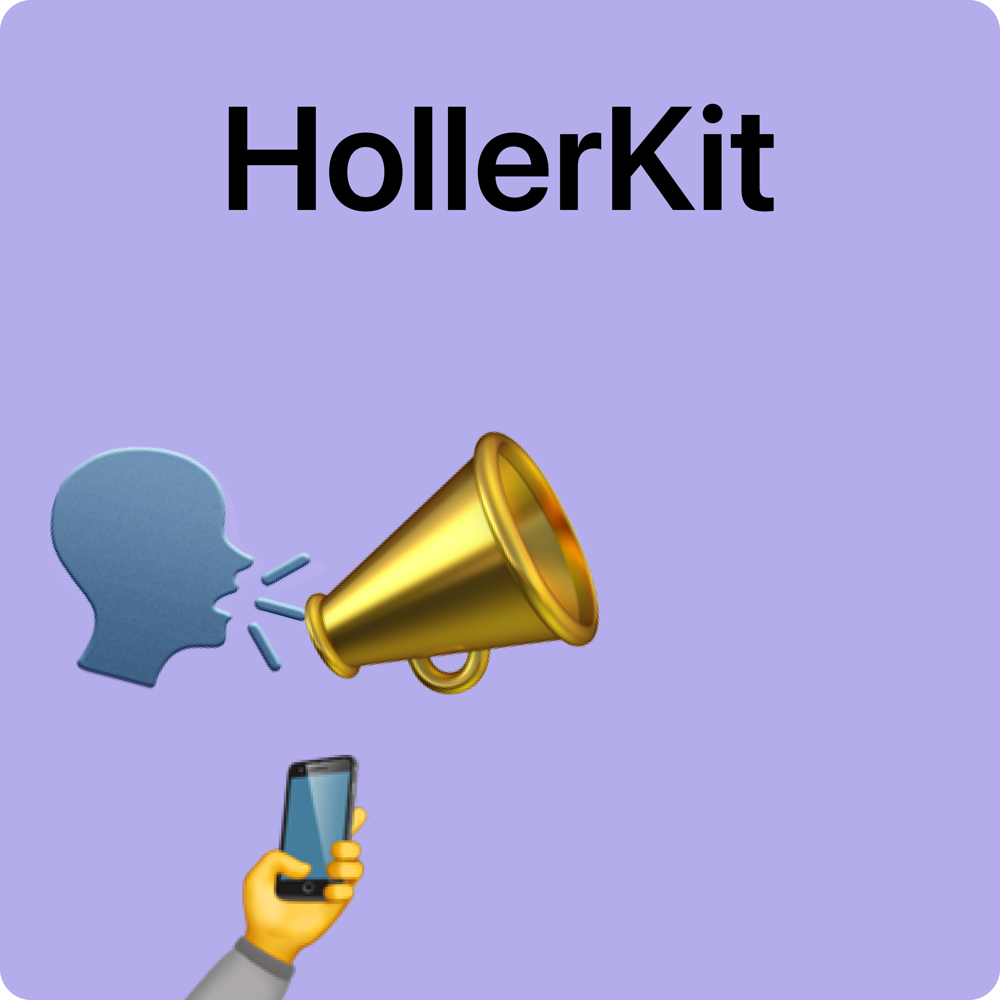
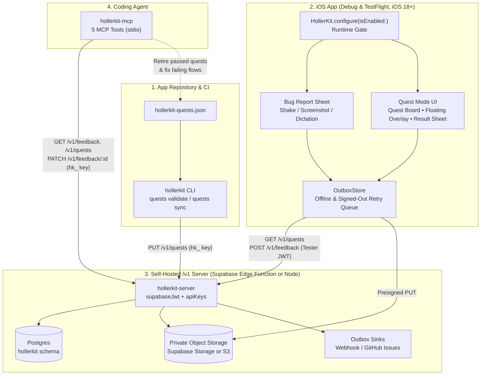
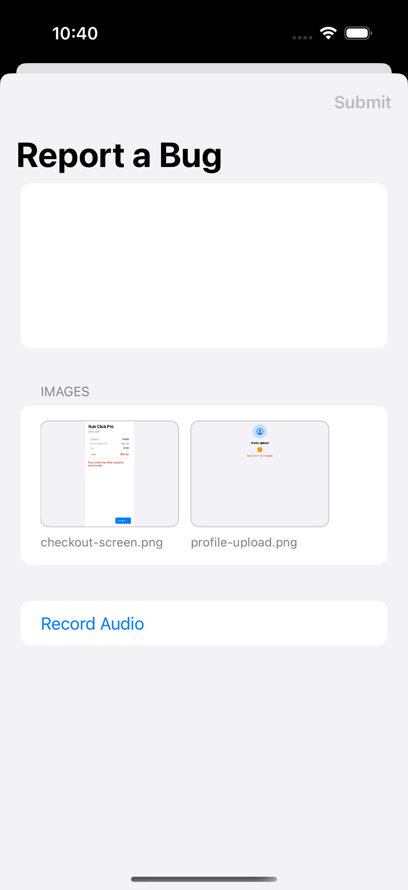
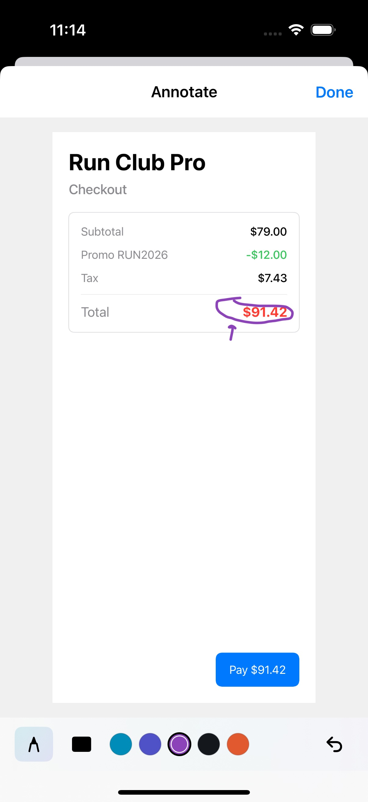
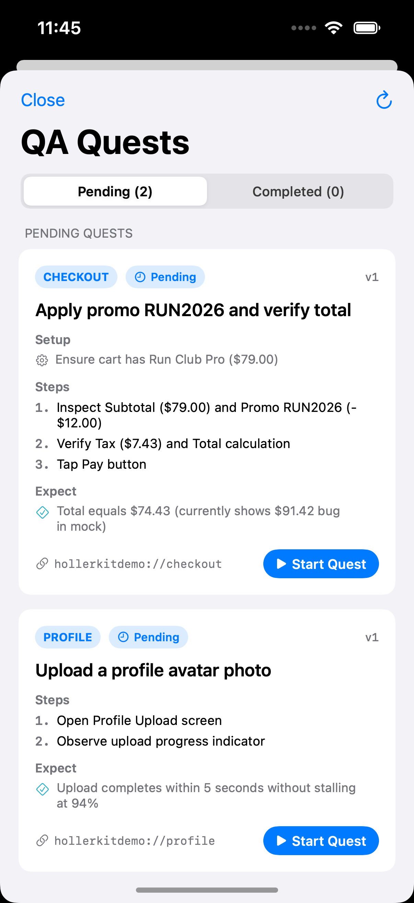
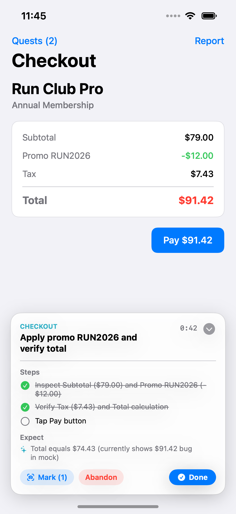
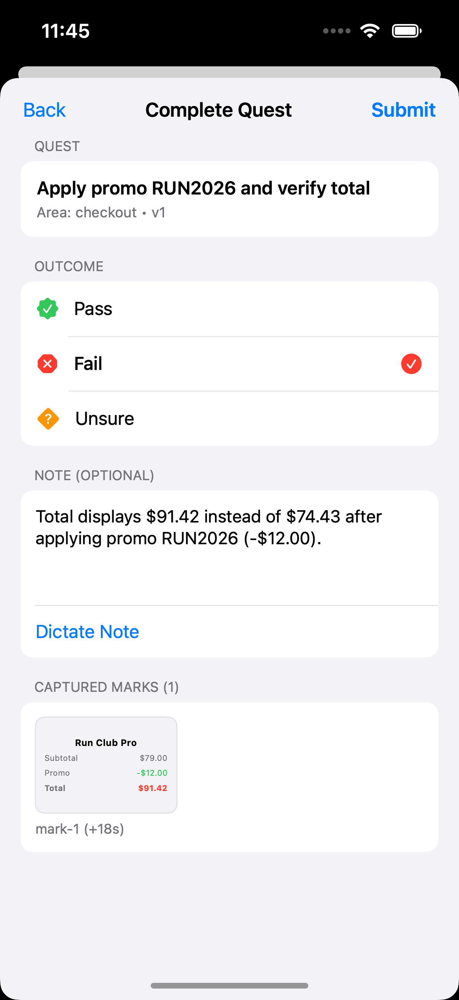

# HollerKit

[](https://github.com/Liampronan/HollerKit/actions/workflows/ci.yml)

<p align="center">
  
</p>

HollerKit is a self-hosted **bug reporting and guided QA quest loop** for iOS apps and coding agents.

It connects four pieces into a single loop:

1. **`hollerkit-quests.json` in your app repo** —When you or a coding agent open a PR, you add or update QA test quests alongside the code. CI validates the manifest on every PR and syncs active quests to your server on merge to `main`.
2. **`HollerKit` iOS SDK (`ios/`, iOS 18+)** — Runs inside your Debug and TestFlight builds (gated at runtime via `isEnabled`). Testers can shake or screenshot to file ad-hoc bug reports, or open the **QA Quests** board to run guided test scenarios with a floating step-by-step overlay, one-tap screenshot marks, voice dictation, and an offline-tolerant outbox.
3. **`hollerkit-server` (`server/`, `1.0.0-beta.1`)** — A lightweight `/v1` HTTP handler for **Supabase Edge Functions** or **Node.js**. It stores quests, feedback, and outbox notifications in a dedicated `hollerkit` Postgres schema and issues short-lived presigned URLs for private screenshots in **Supabase Storage** or **S3-compatible object storage**.
4. **`hollerkit-mcp` (`mcp/`, `1.0.0-beta.1`)** — A Model Context Protocol (MCP) server that gives coding agents (Claude Code, Cursor, Codex, etc.) direct access to the feedback inbox, signed screenshot attachments, quest runs, and passed quests ready to retire from `hollerkit-quests.json`.

---

## How It Fits Together



---

## Screenshots

### Bug Report Sheet & Image Annotation Editor

<p>
  
  
</p>

### Guided QA Quest Mode (Quest Board, Floating Overlay & Result Sheet)

<p>
  
  
  
</p>

---

## 1. iOS SDK Quickstart (`ios/`)

HollerKit's Swift package targets **iOS 18+** and uses zero third-party Swift dependencies.

### Add the Package

In Xcode, choose **File > Add Package Dependencies** and add this repository (or select `HollerKit/ios` via **Add Local...** during development).

### Configure at App Launch

```swift
import HollerKit
import SwiftUI

@main
struct MyApp: App {
    init() {
        HollerKit.configure(
            server: URL(string: "https://your-project.supabase.co/functions/v1/hollerkit")!,
            auth: {
                // Return the signed-in tester's current JWT, or nil when signed out.
                try? await supabase.auth.session.accessToken
            },
            isEnabled: {
                // Keep HollerKit active in Debug and TestFlight builds, disabled in App Store builds.
                HollerKitEnvironment.isDebugOrTestFlight
            },
            invocation: [.shake, .screenshot],
            inputMode: .textAndAudio,
            metadata: { ["buildChannel": "testflight"] },
            captureBreadcrumbs: true,
            quests: .server { route in
                // Optional deep-link handler when a tester taps "Start Quest"
                AppRouter.shared.navigate(to: route)
            }
        )
    }

    var body: some Scene {
        WindowGroup {
            RootView()
                .hollerKitPresenter()
        }
    }
}
```

### Why Runtime Gating (`isEnabled`) Matters for TestFlight

**TestFlight builds are compiled using the Release build configuration.** If you wrap HollerKit in `#if DEBUG`, it is compiled out of your TestFlight archive and beta testers cannot report bugs or run QA quests.

Instead, keep `HollerKit` linked and gate it at runtime with `isEnabled`:

- When `isEnabled()` returns `false` (such as on public App Store installs when using `HollerKitEnvironment.isDebugOrTestFlight`), `HollerKit` installs no shake or screenshot observers, renders no UI, records no breadcrumbs, makes no network requests, and turns `HollerKit.presentBugReport()` / `HollerKit.presentQuests()` into no-ops.
- **Required `Info.plist` keys:** Because TestFlight builds are Release archives, any target that ships `HollerKit` with voice dictation enabled must include both privacy strings in `Info.plist`:
  - `NSMicrophoneUsageDescription`
  - `NSSpeechRecognitionUsageDescription`
- **Offline & signed-out resilience:** If a tester submits a bug report or finishes a quest while offline or before signing in, `OutboxStore` saves the submission JSON and screenshot files to Application Support (without ever persisting auth tokens) and flushes them automatically once network connectivity and `auth()` are available.

### Recommended App-Side Wrapper Pattern

To keep your app views decoupled from `HollerKit`, wrap it behind a small app-side protocol with a live implementation and a no-op implementation:

```swift
import HollerKit

@MainActor
protocol QAFeedbackService {
    func configure()
    func breadcrumb(_ message: String, category: String?)
    func presentBugReport()
    func presentQuests()
}

struct LiveQAFeedbackService: QAFeedbackService {
    func configure() {
        HollerKit.configure(
            server: URL(string: "https://your-project.supabase.co/functions/v1/hollerkit")!,
            auth: { try? await AuthManager.shared.currentAccessToken() },
            isEnabled: { HollerKitEnvironment.isDebugOrTestFlight }
        )
    }

    func breadcrumb(_ message: String, category: String? = nil) {
        HollerKit.breadcrumb(message, category: category)
    }

    func presentBugReport() { HollerKit.presentBugReport() }
    func presentQuests() { HollerKit.presentQuests() }
}

struct NoOpQAFeedbackService: QAFeedbackService {
    func configure() {}
    func breadcrumb(_ message: String, category: String? = nil) {}
    func presentBugReport() {}
    func presentQuests() {}
}
```

---

## 2. Server Quickstart (`server/`)

`hollerkit-server` (`1.0.0-beta.1`) runs on Web-standard `Request` / `Response` handlers in **Supabase Edge Functions** or **Node.js 22+**.

### Step 1: Apply the Database Migration

Copy the SQL migration into your project and apply it to your Postgres database (creates the isolated `hollerkit` schema with RLS enabled):

```sh
npx hollerkit-server migrations copy ./supabase/migrations
```

### Step 2: Deploy on Supabase Edge Functions

See [`examples/supabase/index.ts`](./examples/supabase/index.ts) and [`examples/supabase/config.toml`](./examples/supabase/config.toml):

```ts
import {
  apiKeys,
  createHollerKitServer,
  postgresStore,
  supabaseJwt,
  supabaseStorage,
} from 'npm:hollerkit-server'

const supabaseUrl = Deno.env.get('SUPABASE_URL')!
const store = postgresStore({
  url: Deno.env.get('SUPABASE_DB_URL')!,
  prepare: false, // Required for Supabase Supavisor transaction pooling
})

const storage = supabaseStorage({
  url: supabaseUrl,
  serviceRoleKey: Deno.env.get('SUPABASE_SERVICE_ROLE_KEY')!,
  bucket: Deno.env.get('HOLLERKIT_BUCKET') ?? 'hollerkit',
})

Deno.serve(
  createHollerKitServer({
    store,
    storage,
    authenticate: [
      supabaseJwt({
        jwksUrl: `${supabaseUrl}/auth/v1/.well-known/jwks.json`,
        secret: Deno.env.get('SUPABASE_JWT_SECRET'),
        store,
      }),
      apiKeys({ store }),
    ],
  }),
)
```

In `supabase/config.toml`, disable Supabase's gateway JWT check on the `hollerkit` function so both tester Supabase Auth JWTs and `hk_...` API keys (used by CI and `hollerkit-mcp`) reach HollerKit's own authenticator chain:

```toml
[functions.hollerkit]
verify_jwt = false
```

For a standalone Node.js + S3 deployment, see [`examples/nodejs/index.ts`](./examples/nodejs/index.ts).

---

## 3. CLI Quickstart (`hollerkit`)

The `hollerkit` CLI ships inside `hollerkit-server`:

```sh
# 1. Validate hollerkit-quests.json in CI and print canonical SHA-256 content hashes
npx hollerkit-server quests validate ./hollerkit-quests.json

# 2. Sync quests to your server on merge to main
npx hollerkit-server quests sync ./hollerkit-quests.json \
  --server https://your-project.supabase.co/functions/v1/hollerkit \
  --key "$HOLLERKIT_QUESTS_WRITE_KEY" \
  --sha "$GITHUB_SHA"

# 3. Create scoped hk_ API keys for CI (quests:write) or coding agents (agent:read,agent:triage)
npx hollerkit-server keys create \
  --db "$DATABASE_URL" \
  --scopes agent:read,agent:triage \
  --label "cursor-agent"

# 4. Revoke an API key by prefix, hash, or label
npx hollerkit-server keys revoke --db "$DATABASE_URL" hk_a1b2c3d4

# 5. Run the 15-step end-to-end /v1 conformance suite against a live server
npx hollerkit-server conformance \
  --server http://127.0.0.1:3000 \
  --tester-token "$TESTER_TOKEN" \
  --quests-key "$QUESTS_KEY" \
  --agent-key "$AGENT_KEY"

# 6. Copy SQL migrations into your project
npx hollerkit-server migrations copy ./migrations
```

---

## 4. Coding Agent MCP Quickstart (`mcp/`)

`hollerkit-mcp` (`1.0.0-beta.1`) is a zero-dependency stdio MCP server that connects your coding agent to your `/v1` server.

### Configure in Claude Code / Cursor / MCP Client

```json
{
  "mcpServers": {
    "hollerkit": {
      "command": "npx",
      "args": ["-y", "hollerkit-mcp"],
      "env": {
        "HOLLERKIT_URL": "https://your-project.supabase.co/functions/v1/hollerkit",
        "HOLLERKIT_API_KEY": "hk_your_agent_api_key"
      }
    }
  }
}
```

### Provided MCP Tools

| Tool | Required Scope | Description |
| :--- | :--- | :--- |
| `hollerkit_inbox` | `agent:read` | List feedback items and quest runs with filters (`status`, `kind`, `quest_id`, `result`, `build`, `since`, `limit`, `cursor`) and summary counts. |
| `hollerkit_get_feedback` | `agent:read` | Fetch full details for a bug report or quest run, including breadcrumbs, timeline marks, and fresh signed URLs for screenshots. |
| `hollerkit_triage` | `agent:triage` | Update a feedback item's status (`open`, `triaged`, `in_progress`, `resolved`, `wontfix`), `resolution_note`, `resolved_in_sha`, or `external_issue_url`. |
| `hollerkit_quests_status` | `agent:read` | List active quests with per-quest pass/fail/unsure/abandoned counts, last run timestamp, and tester coverage. |
| `hollerkit_quests_retire_candidates` | `agent:read` | Identify active quests whose current `content_hash` has enough passing runs (`min_passes`, default `1`) and zero failing runs so the agent can remove them from `hollerkit-quests.json`. |

---

## Production App Checklist

Before shipping a build that links HollerKit:

- Gate the SDK at runtime via `isEnabled` (e.g. `HollerKitEnvironment.isDebugOrTestFlight` or a staff account check) and enforce tester allowlists (`hollerkit.testers`) on the server.
- Keep Supabase service role keys, S3 credentials, database URLs, and `hk_` API keys on the server or CI/agent environment only—never in the iOS binary.
- Use private attachment buckets so screenshots are only accessed via short-lived presigned URLs.
- Include `NSMicrophoneUsageDescription` and `NSSpeechRecognitionUsageDescription` in `Info.plist` for any target that enables voice dictation.

---

## Protocol & Security Documentation

- **[`QUEST_PROTOCOL.md`](./QUEST_PROTOCOL.md)** — Canonical `/v1` wire specification, authentication scopes, `content_hash` algorithm, upload grants, and cursor pagination rules.
- **[`quest-protocol.yaml`](./quest-protocol.yaml)** — OpenAPI 3.1 specification for all `/v1` endpoints.
- **[`PRIVACY.md`](./PRIVACY.md)** — Privacy guarantees for screenshots, redaction, speech transcription, and tester identity.
- **[`SECURITY.md`](./SECURITY.md)** — Vulnerability reporting and `/v1` security model.

---

## What v0.5 Was

HollerKit **v0.5** was an earlier, stateless pipeline where the iOS SDK signed `multipart/form-data` payloads with an in-binary HMAC secret and the server uploaded screenshots and opened GitHub Issues directly.

If you need the legacy v0.5 HMAC handler (`createBugReportHandler` / `githubIssues`), pin the [`v0.5-archive`](https://github.com/Liampronan/HollerKit/tree/v0.5-archive) git tag.
