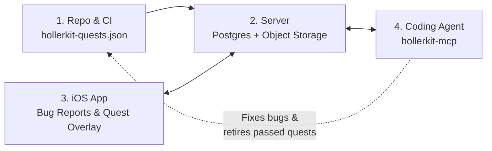

# HollerKit

[](https://github.com/Liampronan/HollerKit/actions/workflows/ci.yml)

<p align="center">
  
</p>

HollerKit closes the QA loop between **coding agents**, **iOS builds**, and **human testers**.

When you or a coding agent build a feature, it's easy to write unit tests—but hard to verify how the feature actually feels on a real iPhone. HollerKit lets your agent ship a checklist of **QA Quests** alongside its code, gives testers an in-app overlay to step through those flows (or shake to file bug reports), and exposes the results back to your coding agent via MCP.

---

## How the Loop Works

1. **Write a quest in `hollerkit-quests.json`** — Alongside a feature PR, you (or your agent) add a short test scenario: setup instructions, steps to try, and what should happen.
2. **Test on iPhone (Debug or TestFlight)** — Testers open the **QA Quests** board inside your app. A floating overlay walks them through each step, lets them tap **Mark** to capture annotated screenshots or voice notes, and records **Pass**, **Fail**, or **Unsure**. (Testers can also shake or screenshot at any time to file regular bug reports.)
3. **Agent fixes failures & retires passed quests** — Your coding agent connects via `hollerkit-mcp` to read bug reports, inspect screenshots, fix broken flows, and remove quests from `hollerkit-quests.json` once they've passed on a real device.



---

## Screenshots

### Bug Report Sheet & Screenshot Annotation

<p>
  
  
</p>

### Guided QA Quests (Board, Floating Overlay & Outcome Sheet)

<p>
  
  
  
</p>

---

## Quickstart

HollerKit is split into three small packages. Pick the guide for the part you're setting up:

| Component | Directory | Guide |
| :--- | :--- | :--- |
| **iOS SDK** (SwiftUI, iOS 18+, zero dependencies) | `ios/` | **[iOS SDK Guide (`ios/README.md`)](./ios/README.md)** |
| **Server & CLI** (Supabase Edge Functions or Node.js + Postgres/S3) | `server/` | **[Server & CLI Guide (`server/README.md`)](./server/README.md)** |
| **Coding Agent MCP** (Claude Code, Cursor, Codex) | `mcp/` | **[MCP Guide (`mcp/README.md`)](./mcp/README.md)** |

### Minimal iOS Setup

```swift
import HollerKit
import SwiftUI

@main
struct MyApp: App {
    init() {
        HollerKit.configure(
            server: URL(string: "https://your-project.supabase.co/functions/v1/hollerkit")!,
            auth: { try? await supabase.auth.session.accessToken },
            isEnabled: { HollerKitEnvironment.isDebugOrTestFlight },
            invocation: [.shake, .screenshot],
            quests: .bundled("hollerkit-quests") { route in
                AppRouter.shared.navigate(to: route)
            }
        )
    }

    var body: some Scene {
        WindowGroup {
            RootView()
                .hollerKitPresenter()
        }
    }
}
```

> **Tip:** Always gate HollerKit at runtime with `isEnabled` (`HollerKitEnvironment.isDebugOrTestFlight`) rather than `#if DEBUG`—TestFlight builds use the Release configuration, so `#if DEBUG` would strip HollerKit out for beta testers. See [`ios/README.md`](./ios/README.md) for details.

---

## Reference & Security Docs

- **[`ios/README.md`](./ios/README.md)** — iOS SDK setup, TestFlight gating, `Info.plist` keys, offline queueing, and protocol wrapper pattern.
- **[`server/README.md`](./server/README.md)** — Database migration, private storage bucket, tester allowlist, Supabase/Node deployment, and `hollerkit` CLI commands.
- **[`mcp/README.md`](./mcp/README.md)** — MCP client configuration and tool reference.
- **[`QUEST_PROTOCOL.md`](./QUEST_PROTOCOL.md)** & **[`quest-protocol.yaml`](./quest-protocol.yaml)** — HTTP `/v1` wire specification and OpenAPI 3.1 schema.
- **[`PRIVACY.md`](./PRIVACY.md)** & **[`SECURITY.md`](./SECURITY.md)** — Privacy guarantees and security model.

---

## Looking for v0.5?

HollerKit **v0.5** was an earlier stateless pipeline that posted directly to GitHub Issues using an HMAC secret. If you need the legacy v0.5 handler, use the [`v0.5-archive`](https://github.com/Liampronan/HollerKit/tree/v0.5-archive) tag.
